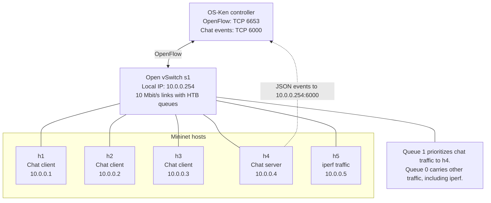

# SDN Multi-Client Chat

This project is a TCP chat app and a small network built with Mininet and
Open vSwitch. The OS-Ken controller can give chat traffic priority and block
users. The lab can also compare the network with and without the controller.

## What you need

- Linux, Python 3, Mininet, Open vSwitch, and `iperf`
- `sudo` access
- `xterm` and a graphical display for the interactive lab
- Optional: `tcpdump` and Wireshark to capture and view packets

## Set up

From the project folder, run:

```sh
source setup_osken_env.sh
```

This sets up the local Python environment and installs the needed packages.
The controller and chat client use this environment.

## Run a chat

Open two terminals in the project folder. Start the server in one:

```sh
python3 server.py
```

Start a client in the other:

```sh
./.venv-sdn/bin/python client.py 127.0.0.1
```

Follow the prompts to pick a name and room. You can send room messages or
private messages from the menu.

## Run the Mininet lab

Start the controller in one terminal:

```sh
./.venv-sdn/bin/osken-manager --ofp-tcp-listen-port 6653 \
  sdn/chat_qos_controller.py
```

In another terminal, start the lab:

```sh
sudo mn -c
sudo env PATH="$HOME/.local/bin:$PATH" \
  LD_LIBRARY_PATH="$HOME/.local/opt/xterm/usr/lib/x86_64-linux-gnu" \
  python3 mininet_lab.py lab --mode sdn
```

The lab opens chat windows on h1, h2, and h3. Pick a different name in each
window and join the same room. To run without OS-Ken, use:

```sh
python3 mininet_lab.py lab --mode baseline
```

Type `exit` at the Mininet prompt when you are done. If a lab stops without
cleaning up, run `sudo mn -c` before starting another one. Press **Ctrl+C** in
the controller terminal to stop OS-Ken.

## View traffic in Wireshark

Start the SDN lab and send some chat messages. In another terminal, capture
traffic on the switch port connected to the chat server:

```sh
sudo tcpdump -i s1-eth4 -w chat-lab.pcap \
  'tcp port 5000 or tcp port 5001'
```

Press **Ctrl+C** to stop the capture, then open it in Wireshark:

```sh
wireshark chat-lab.pcap
```

Use the display filter `tcp.port == 5000 || tcp.port == 5001` to show chat and
iperf traffic. In Wireshark, **Statistics → I/O Graphs** can show when packets
were sent. A packet capture helps show network activity, but it does not
replace the latency measurements saved in `results.csv`. Private-message text
is encrypted and will not appear as readable text.

## Private messages

Choose **Send an encrypted private message**, then enter the other person's
online name and your message. The clients encrypt and decrypt it; the server
only forwards the encrypted text. In normal mode, compare the person's key
fingerprint through another trusted method before trusting it.

For a local demo, start the server as shown above. Then run this command in
two terminals and choose a different name in each:

```sh
./.venv-sdn/bin/python client.py 127.0.0.1 --crypto-demo
```

Demo mode automatically trusts the keys it receives. Use it only in a trusted
lab. A malicious server could replace those keys.

## Block a user

After a user joins a room, block or unblock them from another terminal:

```sh
sudo python3 mininet_lab.py block --user alice
sudo python3 mininet_lab.py unblock --user alice
```

To see the switch rules, run:

```sh
sudo ovs-ofctl -O OpenFlow13 dump-flows s1
```

## Measure the network

Make sure the controller is running and no other Mininet lab is open. Run:

```sh
sudo mn -c
sudo python3 mininet_lab.py measure --mode sdn \
  --clients 10 50 100 --runs 5 --output results.csv
```

This runs baseline and SDN tests, with and without an `iperf` flood. Results
are saved to `results.csv` and `results_summary.csv`. Use `--mode baseline` for
baseline-only tests. Use a new output file name if you want to keep old results.

## Main files

- `server.py` and `client.py`: chat server and client
- `sdn/chat_qos_controller.py`: OS-Ken controller
- `mininet_lab.py`: Mininet lab and measurement commands
- `config.py`: network settings
- `setup_osken_env.sh`: environment setup

## Network diagram



See [network-diagram.md](docs/network-diagram.md) for the standalone diagram.
