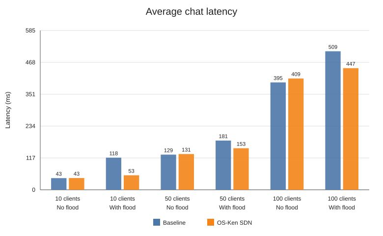
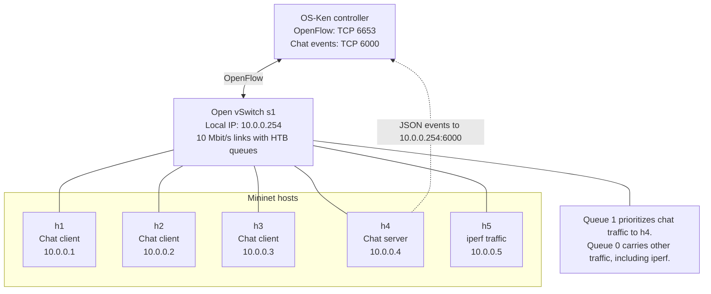

# SDN Multi-Client Chat

This project is a TCP chat app and a small network built with Mininet and
Open vSwitch. The OS-Ken controller can give chat traffic priority and block
users. The lab can also compare the network with and without the controller.

## What you need

- Tested versions:
  - Linux (Ubuntu recommended)
  - Python 3.14.8 for the server and Mininet; Python 3.12.16 for OS-Ken and
    the chat clients
  - Mininet 2.3.1b4 and Open vSwitch 3.6.2
  - `iperf` 2.2.1 and `xterm` 411
  - OS-Ken 4.2.2, Eventlet 0.41.3, and cryptography 50.0.2
  - `uv` 0.13.7 for setup
- `sudo` access for Mininet and OVS.
- The setup script installs the Python environment and pinned packages in
  `.venv-sdn`.
- `xterm` is only needed to open separate interactive client windows.

## Set up

From the project folder, run:

```sh
source setup_osken_env.sh
```

This sets up the local Python environment and installs the needed packages.
The controller and chat client use this environment.

## Run the Mininet server lab

Start the controller in one terminal:

```sh
./.venv-sdn/bin/python sdn/run_controller.py --ofp-tcp-listen-port 6653
```

In another terminal, start the lab:

```sh
service openvswitch start
sudo mn -c
sudo env PATH="$HOME/.local/bin:$PATH" \
  LD_LIBRARY_PATH="$HOME/.local/opt/xterm/usr/lib/x86_64-linux-gnu" \
  python3 mininet_lab.py lab --mode sdn
```

At the `mininet>` prompt, open the chat terminals yourself:

```text
xterm h1 h2 h3
```

The chat client starts automatically in each terminal. Choose a different
account name in each window and join the same room. Type `exit` at the Mininet
prompt to close the lab and its xterm windows.

In the chat menu, choose **Leave this room** to stay signed in without being
in a room. You can join a room again from the no-room menu.

If a lab stops without cleaning up, run `sudo mn -c` before starting another
one. Press **Ctrl+C** in the controller terminal to stop OS-Ken.

When a chat window opens, choose register or login, then enter an account name
and password. Passwords must be 8-128 characters with no spaces. The server
saves salted scrypt password hashes in `accounts.json`(encrypted with `sudo` access), not the passwords.
Choose **Log out** in the chat menu to sign out and return to the account
prompt. Passwords travel over the lab's plain TCP connection, so do not reuse
an important password. When the interactive Mininet lab exits, it clears all
saved accounts so you can register them again next time.

## Private messages

Choose **Send an encrypted private message**, then enter the other person's
online name and your message. The clients encrypt and decrypt it; the server
only forwards the encrypted text. Before delivering a private message, the
recipient is asked whether they trust the sender. Chat windows do not display
public keys or fingerprints. If accepted, that key is trusted for the rest of
the session; a changed key asks for trust again. Declining prevents delivery.
The controller log shows users' public keys and each PM trust decision.
`verified=true` means the recipient accepted the sender's key; it does not
mean the controller confirmed the sender's identity.

The clients use X25519 to agree on a shared secret, then HKDF-SHA256 derives an
encryption key. ChaCha20-Poly1305 encrypts the message and checks that it has
not been changed. The server only forwards the encrypted text.

The server relays messages and supplies public keys, so a malicious server
could replace a key. Accept only if you trust the sender; the chat prompt does
not let you compare their fingerprint.

## Block a user

After a user joins a room, block or unblock them from another terminal:

```sh
sudo python3 mininet_lab.py block --user alice
sudo python3 mininet_lab.py unblock --user alice
```

To see the switch rules, run:

```sh
sudo ovs-ofctl -O OpenFlow13 dump-flows s1
```

The output shows rules by priority. A user's normal chat rule has priority 100
and sends their traffic through the chat queue. After blocking them, that rule
is replaced with a priority 200 rule with no actions, so matching traffic is
dropped. The rule matches the user's IP address and chat connection port.

## Measure the network

1. Start the OS-Ken controller as described above. Close any other Mininet lab.
2. Run the tests:

```sh
sudo mn -c
sudo python3 mininet_lab.py measure --mode sdn \
  --clients 10 50 100 --runs 5 --output results.csv
```

This tests both baseline and SDN, with and without an `iperf` flood. Add
`--mode baseline` to test only the baseline. Use a new output name to keep
previous results.

To run baseline-only tests, no controller is needed. Clean up Mininet, then
run:

```sh
sudo mn -c
sudo python3 mininet_lab.py measure --mode baseline \
  --clients 10 50 100 --runs 5 --output baseline_results.csv
```

This writes chat latency to `baseline_results.csv` and
`baseline_results_summary.csv`.

3. Check the results:

- `results.csv` and `results_summary.csv` contain chat latency.

4. Make graphs from the CSV files:

```sh
python3 generate_graphs.py
```

This creates `results_graphs/chat_latency.svg`. Run it again after new tests to
update the graph. The chat latency graph below uses the saved summary data; run
new tests after changing the network setup.



In the saved results, SDN is faster in some cases and slower in others. Rerun
the tests before drawing conclusions about the updated network setup.

## View traffic in Wireshark

1. Start the controller for SDN, then start the Mininet lab in baseline or SDN
   mode as described above.
2. Open Wireshark and capture on `s1-eth4`, the switch port connected to the
   chat server. Use this capture filter to keep chat and iperf traffic:

   ```text
   tcp port 5000 or tcp port 5001
   ```

3. Send chat messages from the chat windows. To add an iperf flood, enter these
   commands at the Mininet prompt:

   ```text
   h4 iperf -s -p 5001 &
   h5 iperf -c 10.0.0.4 -p 5001 -t 30
   ```

4. Stop and save the capture  Repeat with and without the flood in both
   baseline and SDN mode.
5. In Wireshark, use the display filter `tcp.port == 5000 || tcp.port == 5001`.
   Open **Statistics → I/O Graphs**, set the interval to one second, and select
   **Bits/Tick** to see throughput. Divide the graph value by 1,000,000 to get
   Mbps. Compare the four captures.

The measurement command still records chat latency in the CSV files. Wireshark
is used here to view and compare captured traffic manually.

## Main files

- `server.py` and `client.py`: chat server and client
- `accounts.py`: stores password hashes for saved accounts
- `sdn/chat_qos_controller.py`: OS-Ken controller
- `sdn/run_controller.py`: starts the OS-Ken controller
- `mininet_lab.py`: Mininet lab and measurement commands
- `config.py`: network settings
- `setup_osken_env.sh`: environment setup
- `generate_graphs.py`: makes graphs from the measurement CSV files

## Network diagram

The five hosts connect to one switch. OS-Ken controls the switch during SDN
tests.


